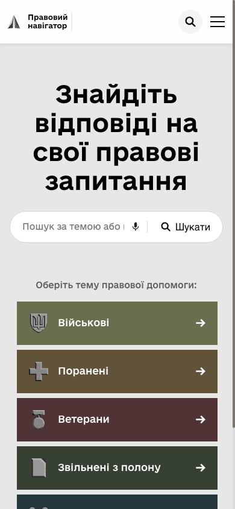
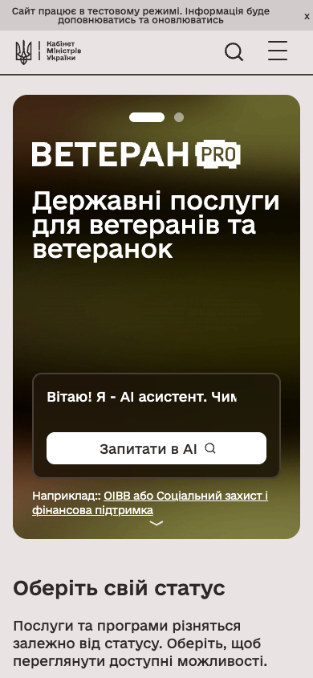
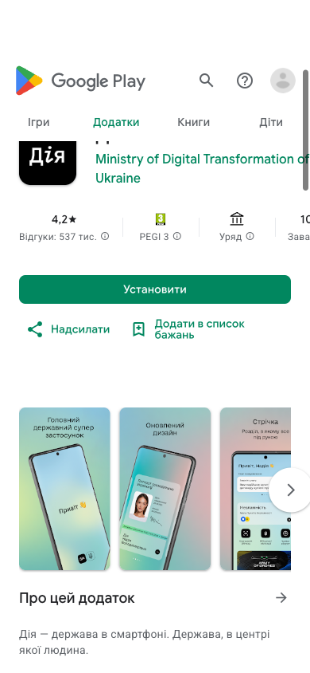
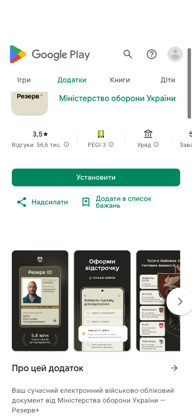

# Информационный и стилистический пак

## PWA-помощник для ветеранов и людей с инвалидностью вследствие войны

**Срез исследования:** 10 ноября 2026 года.  
**Статус:** исходная продуктовая рамка для обсуждения и первого прототипа; это не официальный государственный продукт и не юридическое заключение.

> Это архив исследования. Скриншоты, палитра и сценарии ниже относятся к прототипу. Текущее состояние описано в [README проекта](../README.md), [мобильной документации](../mobile/README.md) и [инструкции по выпуску](store-release.md).

**Материалы:** [скриншот главного экрана прототипа](mvp-preview.png) · [каталог источников гида](official-sources.md).

**Палитра прототипа:** туманно-голубой фон, холодные светлые поверхности и мягкий мятный акцент. Актуальные токены находятся в [styles.css](../styles.css) и [theme.tsx](../mobile/src/theme.tsx).

## 1. Короткий вывод

В Украине уже существует очень близкий по задаче продукт — государственная платформа **«Ветеран PRO»**. На её сайте есть выбор статуса (УБД или ОІВВ), каталог услуг и фильтрация региональных возможностей. При проверке главная страница показывала пометку о тестовом режиме. Для PWA важно не дублировать каталог, а дать человеку **доступный, понятный и проверяемый маршрут от нужной темы к следующему реальному действию**, желательно с возможностью интеграции с «Ветеран PRO» или подтверждённым партнёрством. [Сайт «Ветеран PRO»](https://veteranpro.gov.ua/), [описание платформы Минветеранів](https://mva.gov.ua/prescenter/category/86-novini/veteran-pro--vash-noviy-vhid-do-mozhlivostey-servisiv-i-pidtrimki).

Рабочее позиционирование:

> **PWA-навігатор для ветеранів і людей з інвалідністю внаслідок війни: тематичний пошук, перевірені джерела й покроковий маршрут до послуги.**

Человек выбирает тему в каталоге или задаёт вопрос «Характернику». Оба пути ведут к одной карточке с маршрутом и официальными источниками.

## 2. Что уже есть и чему учиться

| Продукт | Что он делает | Полезный паттерн для PWA | Граница заимствования |
|---|---|---|---|
| **Дія** | Цифровые документы, их передача и государственные услуги. Электронное удостоверение ветерана появляется на основе подтверждённого статуса в Едином государственном реестре ветеранов войны; данные статуса доступны и в разделе «Ветеран PRO». | Документ или статус — на виду; короткий путь к действию; понятное объяснение, почему данные могут не появиться. | Не изображать карточку PWA как юридически действительное удостоверение. Вести пользователя в Дію для официального документа и подписания. Не использовать логотип Дії так, будто продукт создан или одобрен Минцифрой. [Дія: е-посвідчення ветерана](https://diia.gov.ua/news/e-posvidchennia-veterana-v-dii-otrymuite-shvydkyi-dostup-pislia-pidtverdzhennia-v-reiestri), [гайд использования логотипа Дія](https://diia.gov.ua/img/diia-october-prod/sites/1/Diia_LOGO_GUIDE.pdf). |
| **Резерв+** | Электронный военно-учётный кабинет: данные из «Оберега», еВОД с QR, исправление ошибочных данных и поддержка. | Удобная карточка статуса; ясные состояния загрузки и ошибки; исправление данных как отдельный сценарий. | Резерв+ обслуживает другой контекст и аудиторию. Не переносить военно-учётные сценарии и не подавать PWA как канал для военных реестров. [Официальная инструкция Резерв+](https://reserveplus.mod.gov.ua/guide/), [страница приложения Минобороны в Google Play](https://play.google.com/store/apps/details?hl=uk&id=ua.gov.reserveplus). |
| **Правовой навигатор «Принцип»** | Поиск юридической информации, тематические пути, документы и шаблоны. Раздел ветеранов содержит статусы и документы, льготы, жильё, региональные программы, компенсацию ЖКП, медпомощь и сервисный навигатор. | Поиск на первом экране; темы простыми карточками; инструкция по шагам; рядом шаблон, куда обращаться и контакт живого специалиста. [Раздел ветеранов](https://navigator.pryncyp.org/veterans), [документы и шаблоны](https://navigator.pryncyp.org/documents), [о проекте и юридической помощи](https://navigator.pryncyp.org/about). | Это не реестр услуг и не государственный цифровой документ. Источники и сроки действия каждого юридического алгоритма нужно проверять отдельно. |
| **Ветеран PRO** | Государственная платформа и самый близкий референс: статусы УБД/ОІВВ, услуги по основным темам и региональные возможности. Минветеранів сообщало почти о 3 000 услуг, включая услуги громад. [Официальная платформа](https://veteranpro.gov.ua/), [данные Минветеранів о категориях и объёме](https://mva.gov.ua/prescenter/category/86-novini/veteran-pro-vsi-derzhavni-poslugi-dlya-veteraniv-viyni-ta-ihnih-rodin-na-odnomu-portali-3). | Фильтр по статусу и региону; персональная дорожная карта; каталог, где видно ответственную организацию. | До старта нужно найти конкретную неудовлетворённую потребность относительно «Ветеран PRO». Возможные отличия: доступность для разных видов инвалидности, более компактные маршруты, офлайн-доступ к сохранённым инструкциям и контактам, независимая проверка актуальности, интеграция с существующей платформой. Это гипотезы для проверки, а не доказанные преимущества. |

### Что показывает визуальная проверка

- **Дія:** чёрно-белый знак, много воздуха, цифровые документы как карточки. Галерея Google Play подаёт продукт через мягкие цветовые градиенты и крупные демонстрационные экраны. Официальный шрифт цифрового государства — e-Ukraine; Минцифра описывает его как инклюзивную гарнитуру. [Страница шрифта e-Ukraine](https://thedigital.gov.ua/fonts).
- **Резерв+:** в галерее Google Play видны тёмная подложка, сдержанная карточка электронного документа и заметные действия. Это визуально подчёркивает личный кабинет и документ, но не является подходящей готовой айдентикой для ветеранского сервиса.
- **Правовой навигатор:** белая шапка, крупная чёрная типографика, нейтральный светло-серый фон, поиск по центру и цветные плитки тем. На мобильном экране категории превращаются в широкие горизонтальные карточки.
- **Ветеран PRO:** на мобильной главной странице — тёплый светлый фон, большой тёмно-оливковый баннер, поле поиска, ниже выбор статуса и карточки категорий. При открытии в ходе исследования на странице был баннер о тестовом режиме.

Скриншоты — зафиксированные примеры публичных страниц и галерей приложений, просмотренные 10.11.2026. Скриншоты Google Play показывают галереи магазинов, а не прямой вход в авторизованные приложения.

## 3. Для кого проект

### Основные пользователи первой версии

1. **Ветераны и ветеранки, в том числе люди со статусом участника боевых действий (УБД).** Частые задачи: понять доступные льготы и выплаты, восстановить или оформить документы, найти жильё, лечение, работу, обучение, спорт или программу своей громады.
2. **Люди со статусом «особа з інвалідністю внаслідок війни» (ОІВВ).** Нужны отдельные пути по установлению и подтверждению статуса, реабилитации, протезированию, медицинским услугам, компенсациям, социальным гарантиям и адаптации среды.

На украинском интерфейсе использовать официальный термин **«особа з інвалідністю внаслідок війни»**, а не разговорное «інвалід війни». УБД и ОІВВ не следует сводить к одному профилю: условия услуг могут отличаться. В самом «Ветеран PRO» выбор статуса объясняется тем, что программы и услуги зависят от статуса. [«Ветеран PRO»: статусы УБД и ОІВВ](https://veteranpro.gov.ua/).

### Граница первой версии

По текущему запросу ядро — ветераны/ветеранки и ОІВВ. Действующие военные, освобождённые из плена, семьи погибших и родственники не входят в основную навигацию первой версии, даже если соседние продукты обслуживают эти группы. Позже можно добавить режим доверенного представителя, если это будет подтверждено исследованиями и юридической моделью.

### Главная потребность

«У меня есть конкретная ситуация. Скажите, что может мне подойти, какие документы подготовить, куда обратиться и как проверить, что информация ещё действует».

## 4. Содержание и структура продукта

### Темы каталога

Для первой структуры целесообразно взять темы, уже используемые «Ветеран PRO», и добавить понятные маршруты из «Правового навигатора»:

1. Документы, статус и правовая помощь.
2. Здоровье и восстановление: лечение, реабилитация, протезирование, стоматология, психологическая помощь.
3. Социальная защита, выплаты и пенсии.
4. Жильё, инфраструктура и земля.
5. Транспорт и коммунальные льготы.
6. Работа, обучение и переквалификация.
7. Спорт и соревнования.
8. Бизнес, гранты и предпринимательство.
9. Региональные и местные программы.

Эти темы присутствуют в публичном каталоге «Ветеран PRO» и разделах навигатора; перечень здесь — предложенная структура продукта, не утверждение о праве каждого человека на каждую услугу. [Категории «Ветеран PRO»](https://veteranpro.gov.ua/), [обзор региональных и центральных услуг](https://mva.gov.ua/prescenter/category/86-novini/veteran-pro-vsi-derzhavni-poslugi-dlya-veteraniv-viyni-ta-ihnih-rodin-na-odnomu-portali-3).

### Карточка каждой услуги

Каждая запись должна отвечать на одни и те же вопросы:

- **Для кого:** точный статус и дополнительные условия.
- **Что даёт:** услуга, право, выплата или поддержка.
- **Как обратиться:** короткие шаги, включая онлайн/офлайн вариант.
- **Что подготовить:** список документов с пояснением, где взять каждый документ.
- **Куда обращаться:** организация, адрес, контакты, кнопка звонка/перехода.
- **Территория:** страна, область, громада; пометка, если действует только локально.
- **Сроки и сумма:** только если есть актуальный официальный источник; не показывать непроверенные цифры.
- **Источник и актуальность:** прямая ссылка на первоисточник, кто его опубликовал, дата последней проверки и дата действия, если она задана.
- **Следующее действие:** «Подать заявление», «Открыть официальный сервис», «Позвонить», «Сохранить список документов».

Сервис должен показывать дату обновления. Если дата или правило не подтверждены — честно отметить это и дать контакт ответственного органа вместо уверенного ответа.

## 5. Главные вкладки и первый экран

Предложение для нижней навигации PWA:

**Головна · Послуги · Характерник · Контакти · Меню**

Нижняя навигация ведёт к главной странице, каталогу услуг, контактам и информации о проекте. «Поруч» открывает контакты региональных специалистов и организаций.

Структура главного экрана:

1. Шапка: название продукта, поиск, настройки доступности.
2. Необязательный выбор статуса и громады; оба можно пропустить.
3. Поиск: «Яку послугу шукаєте?» с текстовым вводом и необязательным голосовым вводом.
4. Прямой переход к каталогу услуг.
5. Быстрые переходы по частым темам.
6. Блок «Потрібна людина?» с ветеранской линией и юридической помощью.
7. Дата проверки каталога и официальные новости только при наличии практического влияния.

Делать статус и регион явными фильтрами полезнее, чем скрытно выводить их из профиля. До государственной интеграции выбор пользователя не является подтверждением статуса.

## 6. Маршрут к услуге

Пользователь находит тему через поиск или каталог, открывает карточку, читает короткие шаги и выбирает прямое действие: позвонить, открыть официальный сайт или перейти к контакту в области.

- Поиск только находит темы в подготовленном каталоге и не формирует персональные юридические выводы.
- Карточка показывает источник, дату проверки и одну ясную следующую задачу.
- Если тема не найдена, главная страница ведёт к полному каталогу и региональной горячей линии.
- Не запрашиваются идентификаторы, документы или сведения о здоровье.
- Условия льгот и выплат всегда проверяются у ответственного органа; маршрут не подтверждает право на услугу.

## 7. Визуальная система и тон

### Направление

**Спокойная цифровая опора:** надёжная, современная и уважительная. Взять ясную иерархию и чистые карточки Дії, поиск и тематические плитки навигатора, понятные статусы и конкретные действия из Резерв+, а маршрутизацию по статусу/региону — из «Ветеран PRO».

Не копировать чужие логотипы и конкретные экраны. В официальном гайде Дія сказано сохранять форму логотипа и не создавать впечатление совместного производства или спонсорства стороннего продукта. До партнёрства продукту лучше использовать собственный знак и прямо обозначать его как концепт/пилот. [Гайд Дії по использованию логотипа](https://diia.gov.ua/img/diia-october-prod/sites/1/Diia_LOGO_GUIDE.pdf).

### Палитра — стартовая гипотеза

Использовать неяркую тёплую базу и один устойчивый основной цвет: светлый фон, тёмный текст, глубокий сине-зелёный или хвойный цвет для действий, небольшие тёплые акценты для поддержки и предупреждений. Красный — только ошибка/опасность. Отдельные цвета не должны быть единственным способом различить статусы.

Точные HEX-коды следует выбрать после прототипа и проверки контраста. Для обычного текста ориентир WCAG AA — не ниже 4.5:1, для крупного текста — 3:1; видимые границы и состояния элементов также требуют контраста. [W3C: Contrast Minimum](https://www.w3.org/WAI/WCAG22/Understanding/contrast-minimum.html), [чеклист цифровой доступности Дії](https://accessibility.diia.gov.ua/checklists.html).

### Типографика

- Первый кандидат для украиноязычного продукта с государственным контекстом — **e-Ukraine**, официальная гарнитура цифрового государства. Она опубликована для загрузки и заявлена Минцифрой как инклюзивная. Если лицензия/интеграция или рендеринг в браузере создадут проблемы — взять нейтральный sans-serif с полной украинской кириллицей.
- Крупные короткие заголовки, обычный регистр, короткие абзацы и списки действий.
- Для рабочего макета: основной текст 18 px / 26 px, поясняющий текст не мельче 16 px / 22–24 px, заголовок экрана 28–32 px. Это проектные значения для прототипа, не цитата из дизайн-системы Дії.
- Не использовать тонкое начертание на цветном фоне, длинные строки капслоком, выравнивание текста по ширине и важный текст внутри изображений.

### Карточки, кнопки и иконки

- Карточка услуги: простое название, короткое объяснение, подходящий статус/регион и чёткий переход.
- На одной карточке — одна основная кнопка. Текст кнопки называет действие: «Перевірити умови», «Підготувати документи», «Звернутися до ЦНАП».
- Иконки — простые, знакомые, с текстовой подписью. Не назначать смысл цветам или пиктограммам без текста.
- Использовать умеренное скругление и лёгкое разделение карточек; избегать плотных сеток, тяжёлых теней и декоративных анимаций.

### Голос интерфейса

Спокойный, взрослый и уважительный. Не говорить сверху вниз и не называть пользователя «героем» в каждом тексте. Коротко объяснять аббревиатуры: сначала «особа з інвалідністю внаслідок війни (ОІВВ)», дальше — ОІВВ. Вместо «система вас не знайшла» писать «Не вдалося отримати дані з реєстру. Ось що можна перевірити». Основной язык интерфейса для украинского государственного контекста — украинский; языковой переключатель и набор локализаций решить отдельно.

## 8. Доступность и PWA-ограничения

Для этой аудитории доступность — базовое качество продукта, а не дополнительная тема. Проверять по WCAG 2.2 AA и украинским чеклистам цифровой доступности:

- Контраст, масштабирование текста и работа при увеличении до 200%.
- Полное управление клавиатурой, видимый фокус, экранный диктор, семантические заголовки и подписи элементов.
- Большие зоны нажатия: WCAG 2.2 AA допускает минимум 24×24 CSS px в ряде условий; для основных мобильных действий проектировать примерно 44×44 px или больше.
- Не требовать свайпов/перетаскивания для единственного способа действия; не полагаться на цвет, звук или анимацию без альтернативы.
- Текстовый вариант голосового взаимодействия; опция уменьшить анимацию; понятные ошибки без тайм-аута на чтение.
- Короткие пошаговые сценарии и ясный возврат к предыдущему шагу.

Источники: [W3C WCAG 2.2](https://www.w3.org/TR/WCAG22/), [W3C: минимальный размер цели](https://www.w3.org/WAI/WCAG22/Understanding/target-size-minimum.html), [W3C: методы ввода](https://www.w3.org/WAI/WCAG22/Understanding/input-modalities.html), [чеклисты Центра цифровой доступности Дії](https://accessibility.diia.gov.ua/checklists.html).

PWA первого этапа может открывать каталог и сохранять выбранные публичные инструкции для чтения без связи. Она не должна сохранять личные документы, медицинские сведения или статус как будто они подтверждены реестром. В офлайн-режиме явно показывать дату последнего обновления, а обращения и суммы выплат не выдавать за актуальные без подключения.

## 9. Границы MVP

### Включить

- Устанавливаемую мобильную PWA.
- Каталог услуг с фильтрами по УБД/ОІВВ, теме и региону.
- Карточки с пошаговыми инструкциями, документами, контактами и первоисточниками.
- Поиск по каталогу, карточки с шагами, источниками и прямыми контактами.
- Ссылки в официальные формы и приложения, где фактически подаётся заявление.
- Ручную дату проверки контента и простую админ-процедуру обновления.
- Сохранение публичных инструкций/контактов для офлайн-чтения.

### Не обещать в MVP

- Выпуск удостоверения, подтверждение статуса или подачу официального заявления внутри PWA.
- Автоматический доступ к государственным реестрам без согласованной интеграции.
- Юридическое заключение, медицинскую диагностику или гарантирование права на выплату.
- Хранение ID, РНОКПП, медицинских документов или истории личных запросов.

## 10. Материал для короткого предложения министерству

**Проблема:** информация о поддержке ветеранов распределена между государственными сервисами, громадами и организациями; человеку нужно понять применимость услуги, документы и ответственного.

**Идея:** мобильная PWA, которая переводит проверенную информацию в понятный маршрут по региональным услугам, с тематическим поиском, режимом доступности и прямым переходом к официальным сервисам или живому консультанту.

**Важная честность:** «Ветеран PRO» уже решает значительную часть этой задачи. Поэтому предложение министерству должно начинаться с проверки дублирования и разговора об интеграции. Пилот имеет смысл только если он выявляет конкретный пробел или заметно улучшает доступность/завершение пользовательских задач.

Для пилота можно измерять: долю пользователей, дошедших до официального действия; успешность сценариев с экранным диктором и увеличением текста; долю услуг с проверенным источником и свежей датой; где люди прекращают маршрут. Не заявлять эффект заранее — сначала собрать базовые показатели.

## 11. Источники и ограничения исследования

Приоритет отдан первичным источникам: официальным страницам Дії, Мінветеранів, Минобороны, Правового навигатора и W3C. Дизайн-наблюдения сделаны по публичным мобильным страницам и скриншотам галерей Google Play; личные кабинеты и авторизованные сценарии в Дії и Резерв+ не проверялись. Нормы, суммы и региональные программы меняются; перед наполнением реального каталога каждую запись нужно проверять по действующему первоисточнику, указывать дату, территорию и владельца услуги.

Список основных источников:

- [Дія — Google Play](https://play.google.com/store/apps/details?hl=uk&id=ua.gov.diia.app)
- [Дія: е-посвідчення ветерана](https://diia.gov.ua/news/e-posvidchennia-veterana-v-dii-otrymuite-shvydkyi-dostup-pislia-pidtverdzhennia-v-reiestri)
- [Минцифра: шрифт e-Ukraine](https://thedigital.gov.ua/fonts)
- [Резерв+: инструкция Минобороны](https://reserveplus.mod.gov.ua/guide/)
- [Правовой навигатор: ветераны](https://navigator.pryncyp.org/veterans)
- [Правовой навигатор: документы](https://navigator.pryncyp.org/documents)
- [Ветеран PRO](https://veteranpro.gov.ua/)
- [Минветеранів: каталог и региональные услуги](https://mva.gov.ua/prescenter/category/86-novini/veteran-pro-vsi-derzhavni-poslugi-dlya-veteraniv-viyni-ta-ihnih-rodin-na-odnomu-portali-3)
- [WCAG 2.2 — W3C](https://www.w3.org/TR/WCAG22/)
